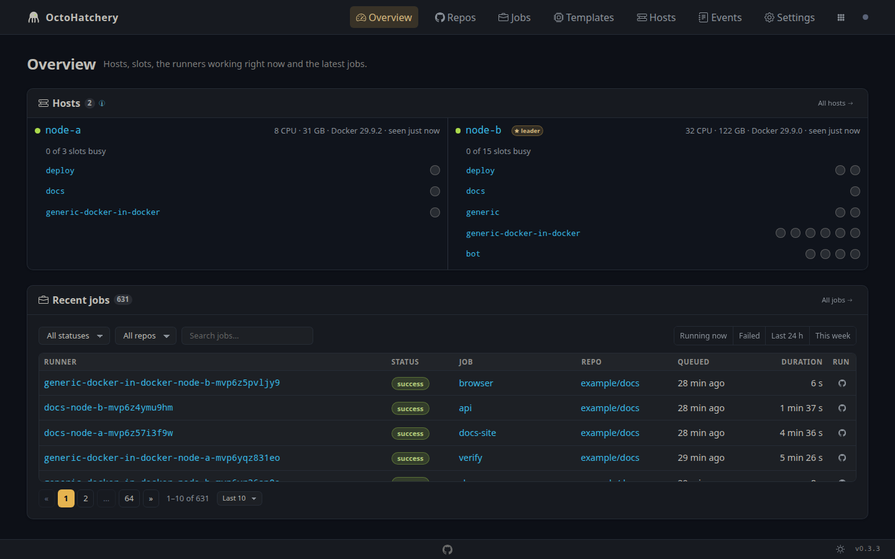
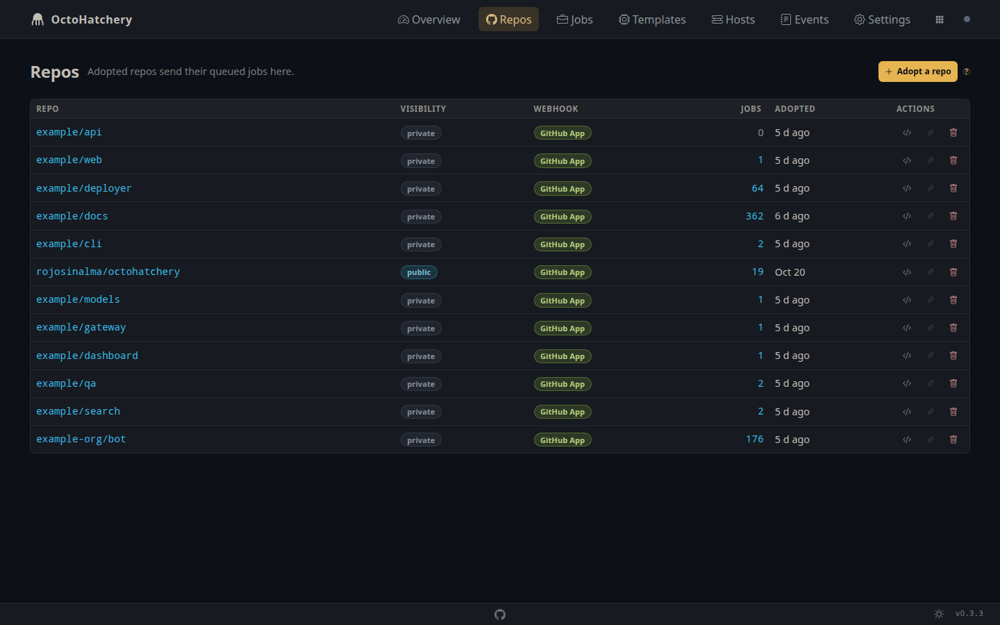
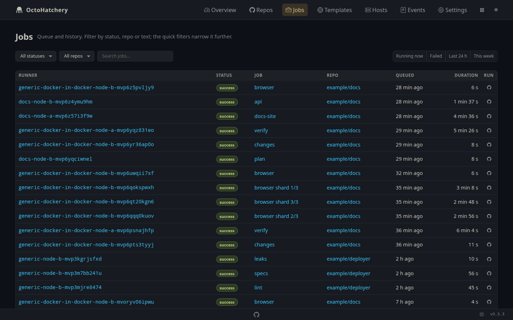
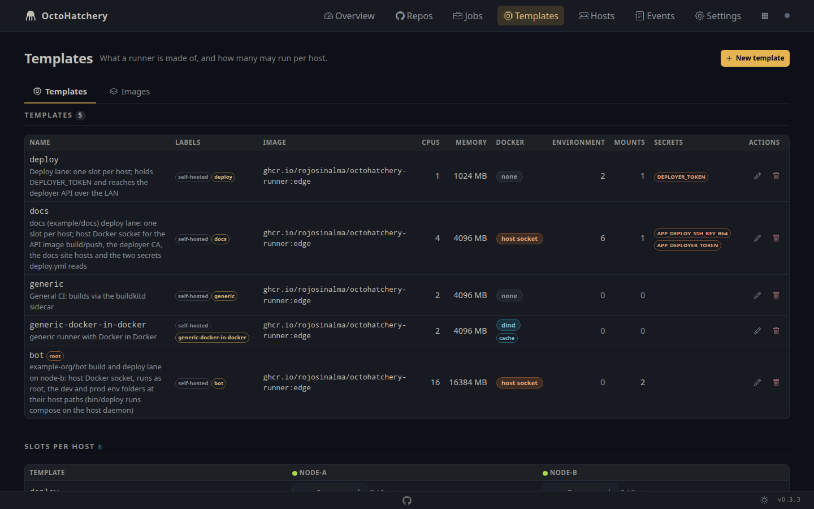
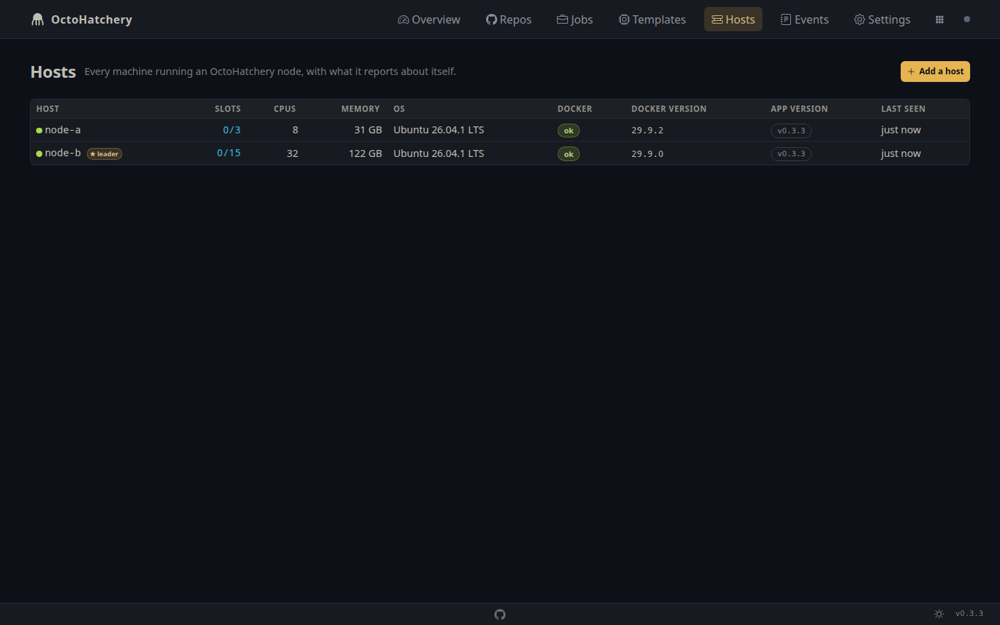
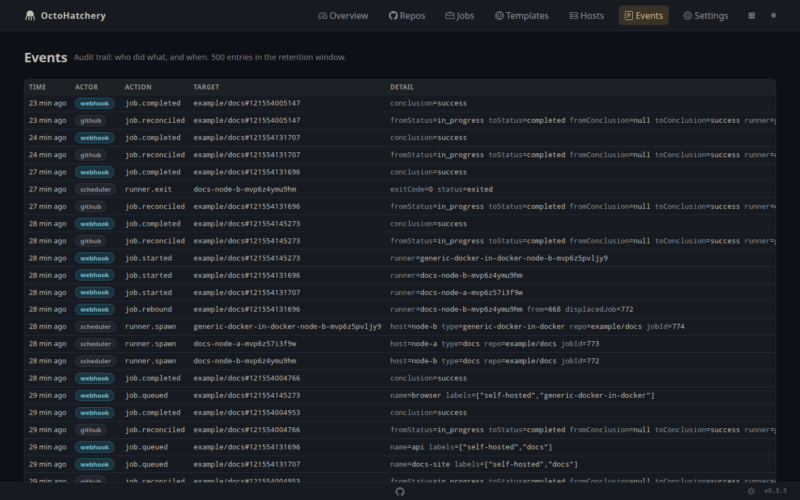
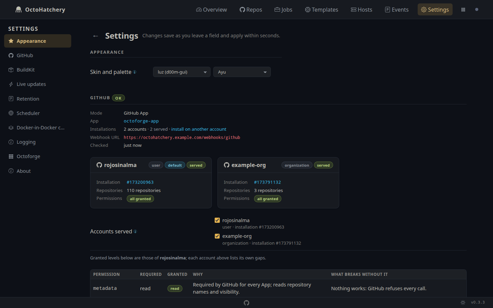

# OctoHatchery

[](https://github.com/rojosinalma/octohatchery/actions/workflows/run-checks.yml)
[](https://github.com/rojosinalma/octohatchery/releases)
[](LICENSE)

|  |  |  |  |
|---|---|---|---|
|  |  |  | |

OctoHatchery is an orchestrator for self-hosted GitHub Actions runners. It is for people who want their own runners on a personal account, without moving their repositories into an organisation.

**You do not need an organisation.** On a personal account, GitHub ties every self-hosted runner to one repository. To share runners between repositories you normally need an organisation and runner groups, which means moving your repositories. OctoHatchery works with a personal account as it is, and with organisations too if you have them.

**Runners are not tied to a single repository.** You do not register runners up front. When a job queues in any repository you adopted, OctoHatchery registers a just-in-time runner for that job. It starts the runner as a fresh container on a host with a free slot and removes it when the job ends. One pool of hosts serves every adopted repository, and nothing waits around between jobs.

What it does:

| Feature | What it does | Docs |
|---|---|---|
| No organisation needed | Works on a personal account. Organisations work too, from the same App, side by side. | [github-app.md](docs/github-app.md#serving-several-accounts) |
| One pool for all your repos | Runners register per job on the repository that queued it, so every adopted repository uses the same hosts. | [Usage](#adopt-a-repository) |
| One runner per job | Each runner gets a single-use just-in-time configuration and runs one job in a clean container. Then OctoHatchery removes it. | [SDD.md](docs/SDD.md) |
| Templates | A runner type is a database row, not code: image, labels, CPU and memory caps, mounts, environment and secret names. Jobs select one with `runs-on`. Edit them in the dashboard, the API or MCP. | [runner-types.md](docs/runner-types.md#fields) |
| Secrets stay on the node | A template holds only the names of secrets. Their values stay in each node's environment and never go into the database. | [runner-types.md](docs/runner-types.md#secrets-names-in-the-type-values-on-the-node) |
| Docker access per template | `none` (default, safest), `socket` (the host's daemon, for trusted repos only) or `dind` (a private Docker-in-Docker daemon for each runner). | [runner-types.md](docs/runner-types.md#docker-access) |
| Docker cache for dind | A `dind` template can keep the daemon's images and build cache per repository between jobs, with limits on disk use. | [runner-types.md](docs/runner-types.md#docker-cache) |
| Shared BuildKit | Every runner can build images through the node's `buildkitd` sidecar, also without Docker access. | [runner-types.md](docs/runner-types.md#docker-access) |
| Private registries | `DIND_CERTS_DIR` gives a node's private registry CAs to every Docker-in-Docker daemon, so pulls and pushes to them work in jobs. | [runner-types.md](docs/runner-types.md#private-registries) |
| Runner image | A shipped image with GitHub's runner and a baked tool cache (Ruby, Bun), so setup steps skip the download. Any image whose entrypoint honours `RUNNER_JITCONFIG` also works. Run as the image's user or as root. | [runner-types.md](docs/runner-types.md#tool-cache) |
| Slots per host | You set how many runners of each template a host may run at once. The scheduler never starts more. | [runner-types.md](docs/runner-types.md#slots-per-host) |
| Images per host | See which hosts have each template's image, and pull it ahead of time from the dashboard. | [runner-types.md](docs/runner-types.md#images) |
| Single or cluster mode | One node on SQLite, or several nodes on a shared PostgreSQL database, each claiming jobs for its own host, with one elected leader. | [operations.md](docs/operations.md#cluster-mode) |
| Live job logs | Each job's log by step, live while it runs and GitHub's final log afterwards. | [dashboard.md](docs/dashboard.md#job) |
| `runs-on` help | Copy the `runs-on` snippet for a template, or let OctoHatchery open a pull request or commit that changes the workflows. | [Usage](#point-a-workflow-at-a-runner-type) |
| GitHub App or token | Use a GitHub App from the shipped manifest (recommended) or a personal access token. Settings shows which permission is missing and what breaks without it. | [github-app.md](docs/github-app.md) |
| Dashboard, API and MCP | The same actions in a browser, over a JSON API, or as Model Context Protocol tools for an agent. | [dashboard.md](docs/dashboard.md), [mcp.md](docs/mcp.md) |
| Monitoring | `/health`, Prometheus `/metrics`, live updates over SSE and an audit log of every action. | [operations.md](docs/operations.md#troubleshooting) |
| Octoforge member | Can run as a member of Octoforge, which hands over the GitHub credentials and the database. | [octoforge.md](docs/octoforge.md) |

Why I built it: I wanted one set of runners for all my repositories without moving them into an organisation. I also did not want to pay for hosted minutes when private repositories build container images.

OctoHatchery is not affiliated with or endorsed by GitHub. GitHub, GitHub Actions and Octocat are trademarks of GitHub, Inc. The octopus here is just a metaphor.

## Requirements

- Docker Engine 24 or newer with Compose v2 on every host that runs runners.
- A GitHub account or organisation, with either a GitHub App you install or a personal access token.
- A public HTTPS URL that GitHub can reach for webhooks, with a reverse proxy in front (see the security notes under Installation).
- Cluster mode only: PostgreSQL 14 or newer.
- Development only: Bun 1.4 or newer.

## Installation

1. Get the compose file and the environment template:

   ```sh
   git clone https://github.com/rojosinalma/octohatchery.git
   cd octohatchery
   cp .env.example .env
   ```

2. Set up GitHub access. [docs/github-app.md](docs/github-app.md) walks through both options: creating a GitHub App from the shipped manifest (recommended) or using a personal access token. Put the resulting values in `.env`.

3. Fill in the rest of `.env`: `MODE` (`single` or `cluster`), `DATABASE_URL`, `HOST_NAME`, `GITHUB_WEBHOOK_SECRET` and the public URL GitHub should call. Every key is documented in [docs/operations.md](docs/operations.md#configuration).

4. Start the node:

   ```sh
   docker compose up -d
   ```

   This starts the app on port 3000 and a `buildkitd` sidecar that runners use for container builds. Open the dashboard, check `/health`, and you are ready to adopt repositories.

For a cluster (several hosts sharing one PostgreSQL database), repeat on each host with the same secrets and a distinct `HOST_NAME`. Details in [docs/operations.md](docs/operations.md#cluster-mode).

### Security notes, read before exposing it

- **There is no login.** The dashboard, API and MCP endpoint trust whoever reaches them. Put OctoHatchery behind a reverse proxy with SSO (Authentik, Authelia, Cloudflare Access, OAuth2 Proxy or similar) and expose only `POST /webhooks/github` without authentication.
- **Webhooks are signed.** Every webhook is checked against `GITHUB_WEBHOOK_SECRET` with HMAC SHA-256 before anything is read from it.
- **The app talks to Docker.** Each node mounts its host's Docker socket (or whatever `DOCKER_HOST` points at). Anyone who controls the app controls that Docker daemon, so treat the app host as trusted.
- **Runners get no Docker by default.** A runner type's **Docker** option decides: `none` (default; builds still go through the shared BuildKit, `services:` and `docker run` fail), `socket` (the host's socket is mounted: every job on that type can control every container on the host, including OctoHatchery) or `dind` (a privileged Docker-in-Docker sidecar per runner, isolated but slower). Use `socket` only for repositories you fully trust; details in [docs/runner-types.md](docs/runner-types.md#docker-access).
- **Permissions are checked, not assumed.** Settings → GitHub compares what the App or token grants with what OctoHatchery needs and says what breaks without each one; a missing permission shows as a banner on every page and in `/health`.
- **Public repositories and forks.** A workflow in a pull request from a fork runs on your hardware if the repository allows it. For public repositories, keep GitHub's "require approval for first-time contributors" setting on, or restrict self-hosted jobs to trusted branches.

## Usage

### Adopt a repository

Open the dashboard, go to **Repos** and press **Adopt a repo**: the dialog lists the repositories your GitHub App installations or token can reach; one click adopts. One App can serve your own account and organisations at once: tick the accounts on **Settings → GitHub** ([docs/github-app.md](docs/github-app.md#serving-several-accounts)). With a token OctoHatchery also registers a webhook for `workflow_job` events; with an App the App's webhook already covers the repo. The same action is available as `POST /api/repos/adopt` and as the MCP tool `adopt_repo`.

### Point a workflow at a runner type

Every runner carries the labels `self-hosted`, its type name and its host name. Pick a type:

```yaml
jobs:
  build:
    runs-on: [self-hosted, generic]
```

Pin a host too when the job needs something only that host has:

```yaml
    runs-on: [self-hosted, generic, build-host-1]
```

The **Repos** page shows the exact snippet for each type. If you prefer, `apply_runs_on` (API or MCP) can open a pull request or commit the change for you.

### Concepts

- **Runner type**: a named recipe for a runner. Image, labels, caps, mounts, env and secret names. Managed from the **Templates** page of the dashboard, the API or MCP.
- **Slot**: the number of runners of one type a host may run at the same time. One slot is taken while a runner spawns, runs and exits.
- **Host**: a node running OctoHatchery with access to a Docker daemon. Hosts register themselves on start.
- **Mode**: `single` runs one node on SQLite or PostgreSQL. `cluster` needs PostgreSQL and lets several nodes claim jobs for their own hosts, with one elected leader running housekeeping.
- **Adoption**: the explicit act of letting a repository use your runners. Jobs from repositories you did not adopt are ignored.
- **`apply_runs_on`**: edits the `runs-on` line in a repository's workflows on request, in one of three modes: `snippet` (just show it), `pr` (open a pull request) or `commit` (commit to the default branch).

### Interfaces

- Dashboard at `/`: Overview, Repos, Jobs (with a live log per job), Templates, Hosts, Events, Settings. See [docs/dashboard.md](docs/dashboard.md).
- JSON API under `/api/`: every response is `{ "ok": true|false, "message": "...", ...data }`.
- MCP at `/mcp` (Streamable HTTP) with the same actions as tools. See [docs/mcp.md](docs/mcp.md).
- `GET /health` for monitoring, `GET /metrics` for Prometheus, `GET /events/stream` for live updates over SSE, `GET /api/jobs/:id/log/stream` for one job's log.

### Documentation

- [docs/github-app.md](docs/github-app.md): GitHub App manifest and setup, personal access token setup.
- [docs/runner-types.md](docs/runner-types.md): the runner image, writing your own types, secrets and mounts.
- [docs/dashboard.md](docs/dashboard.md): the seven pages and what each control does.
- [docs/mcp.md](docs/mcp.md): MCP tools and how to connect an agent.
- [docs/operations.md](docs/operations.md): configuration, single and cluster mode, upgrades, backups, troubleshooting, teardown.
- [docs/octoforge.md](docs/octoforge.md): running under Octoforge: the manifest, the member API, handing over GitHub credentials, the shared database and the member switcher.
- [docs/SDD.md](docs/SDD.md): software design document and the design decisions log.

## Development

```sh
bun install --frozen-lockfile
bun --watch src/index.ts      # live reload on port 3000
bun run typecheck
bun test
bin/verify                     # install, typecheck, tests and a health probe, the same as CI
```

Layout: `src/lib/` holds the logic, `src/db/` the schema and migrations, `src/routes/` the HTTP layer, `src/mcp/` the MCP tools, `src/views/` the server-rendered pages and `runner/` the runner image. Tests live in `test/`. See [CONTRIBUTING.md](CONTRIBUTING.md) for the workflow and [docs/SDD.md](docs/SDD.md) for the design and the decisions behind it.

## License

[AGPL-3.0-only](LICENSE). Copyright 2026 rojosinalma.
